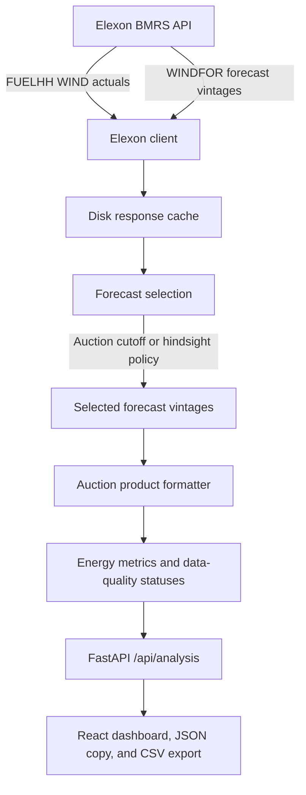

# WindDesk - UK Wind Forecast Evaluation Dashboard

A decision-support analytics dashboard for UK electricity wholesale-market analysts and power-procurement teams.

WindDesk evaluates historical national wind-generation forecasts against actual outturn generation using official Elexon BMRS datasets.

January 2026 is the default demonstration backtest.

Any delivery month can be requested, subject to source availability and the API request-window limit.

The application compares source-published forecasts available at a declared day-ahead auction cutoff with subsequent actual wind output.

It also has a live source view for the latest forecast records returned by Elexon for tomorrow's delivery window.

## 1. Business problem and market context

Day-ahead electricity purchasing depends on expectations of demand and intermittent generation.

Wind-generation forecast errors create volume risk because a procurement decision made before delivery may not reflect the eventual wind outturn.

- **Overforecasting:** Forecast wind exceeds actual wind, leaving less non-wind generation procured than required.
- **Underforecasting:** Forecast wind is below actual wind, leaving more non-wind generation procured than required.

WindDesk answers two operational questions.

1. What national wind forecast was available at the relevant day-ahead decision time for each delivery interval?
2. How accurate was that forecast when compared with actual national wind generation?

The dashboard does not calculate prices, imbalance charges, demand, or trading PnL.

The dashboard does not create a forecast, calculate a bid, recommend a buffer, or recommend an energy purchase volume.

Its role is to present Elexon's source-published forecast data in the auction-product format selected by the user.

## 2. Product and architectural decisions

The following decisions govern the product.

| Decision | Rationale | Consequence |
| --- | --- | --- |
| Use only `FUELHH` and `WINDFOR`. | The assignment scope is national wind actuals and wind forecast vintages. | The application does not add demand, price, imbalance, or third-party weather data. |
| Preserve source publication times. | A trader needs to know what was available at a specific decision moment. | Forecast selection is based on `publishTime`, and the audit view retains source-vintage history. |
| Treat the selected auction as an input contract. | EPEX 60-minute, N2EX 60-minute, and EPEX 30-minute products have different product durations and default cutoff times. | The backend creates an explicit product grid for the chosen auction. |
| Never manufacture a 30-minute forecast. | `WINDFOR` is an hourly source forecast. | A 30-minute product receives half an hour of the published hourly MW rate, with a visible source-allocation status. |
| Use MWh as the primary comparison unit. | Auction products have durations, so energy is more directly comparable than an instantaneous rate. | Forecast, actual, signed error, and absolute error are presented per product in MWh. |
| Keep observed error descriptive. | A historical error rate is useful for reviewing forecast performance, but it is not a forecast of future error. | WAPE is labelled as historical observed error and never as a recommended buffer. |
| Make live and backtest modes distinct. | Future delivery has no actual outturn, while a historical evaluation does. | Live mode displays source-published forecasts only, and switching back restores the prior backtest window. |
| Cache upstream data on the server. | Elexon response windows are repeatedly requested while an analyst changes the presentation controls. | The API persists response records on disk and avoids unnecessary upstream calls. |

## 3. Official Elexon data sources and processing

The backend reads the Elexon Balancing Mechanism Reporting Service REST stream endpoints.

### A. Actual generation - `FUELHH`

- **Endpoint:** `https://data.elexon.co.uk/bmrs/api/v1/datasets/FUELHH/stream`
- **Fuel filter:** Only records where `fuelType` is `WIND` are retained.
- **Delivery interval:** `startTime` as an ISO 8601 UTC timestamp.
- **Generation field:** `generation`, expressed in MW.
- **Resolution:** Half-hourly, with 48 expected settlement intervals per day.

When Elexon provides more than one actual record for an interval, the application retains the latest valid publication.

The API exposes `actual_publish_time` so the dashboard and CSV export can show when the selected actual value became available.

### B. Wind forecast generation - `WINDFOR`

- **Endpoint:** `https://data.elexon.co.uk/bmrs/api/v1/datasets/WINDFOR/stream`
- **Delivery interval:** `startTime` as an ISO 8601 UTC timestamp.
- **Forecast availability:** `publishTime`, which identifies the forecast vintage.
- **Generation field:** `generation`, expressed in MW.
- **Resolution:** Hourly in the January 2026 data returned by the current feed.

## 4. Auction product treatment

The team selects the purchase auction before running analysis.

| Auction | Default cutoff, UTC | Display product | Treatment |
| --- | --- | --- | --- |
| EPEX SPOT GB day-ahead | 09:20 | 60 minutes | One hourly `WINDFOR` MW rate is converted to one hourly MWh product. |
| N2EX day-ahead | 09:50 | 60 minutes | One hourly `WINDFOR` MW rate is converted to one hourly MWh product. |
| EPEX SPOT GB day-ahead | 15:30 | 30 minutes | The published hourly MW rate is shown for each of the two constituent 30-minute products. |

`FUELHH` actuals are half-hourly and `WINDFOR` forecast records are hourly.

For 60-minute products, actual MWh is the sum of the two published half-hour actual MW values multiplied by 0.5 hours.

For 30-minute products, forecast MWh is the published hourly MW value multiplied by 0.5 hours.

This does not interpolate, disaggregate, or manufacture a forecast.

For 30-minute products with both actual and forecast data, the status is `SOURCE_ALLOCATED`.

`SOURCE_ALLOCATED` means the half-hour actual is available and the hourly forecast rate has been transparently allocated to that half-hour for energy comparison.

It deliberately does not use the word `MATCHED`, which is reserved for a direct product-resolution match in the 60-minute views.

The UI and CSV carry the source interval and source-resolution fields so this limitation remains auditable.

## 5. Forecast-selection logic

A delivery interval can have multiple forecasts published as weather models update.

WindDesk chooses one auditable forecast vintage per delivery interval.

1. **Delivery interval:** The forecast and actual share a UTC `startTime`.
2. **Decision cutoff:** The chosen cutoff applies on day `D-1` for delivery day `D`.
3. **Eligibility filter:** A decision-time forecast is eligible only when `publishTime <= cutoff`.
4. **Latest-vintage selection:** The eligible forecast with the latest `publishTime` is selected.
5. **Hindsight mode:** The newest forecast published before delivery is selected for retrospective comparison.

6. **Tie breaking:** When two eligible forecasts have the same `publishTime`, the higher generation value is selected deterministically.

The default cutoff follows the selected auction.

The UI accepts a minute-precise custom UTC cutoff when a user needs to inspect an alternative policy.

The configured auction times are dashboard defaults rather than a claim about an exchange's current contractual schedule.

### Vintage-audit statuses

The vintage audit shows all `WINDFOR` records returned for the selected source delivery hour.

It labels every row using the active decision policy.

| Status | Meaning |
| --- | --- |
| `SELECTED` | The forecast used by the active decision-time, hindsight, vintage, or live selection policy. |
| `ELIGIBLE` | The row was available by the relevant decision rule, but a newer eligible vintage was selected. |
| `AVAILABLE AFTER CUTOFF` | The row was published before delivery but after the selected day-ahead cutoff. |
| `PUBLISHED AFTER DELIVERY` | The row was published after the delivery interval began and cannot represent information known before delivery. |

Rows published after delivery can exist in the Elexon historical feed because the source can later re-publish, correct, backfill, or otherwise record values for an earlier delivery interval.

The application does not treat those records as usable pre-delivery forecasts.

## 6. Evaluation metrics and error convention

Metrics are calculated only from matched actual and selected-forecast auction products.

MWh is primary because an auction product has a duration and its delivered energy is the direct comparison unit.

### Error sign convention

```text
Signed energy error = forecast MWh - actual MWh
```

- A positive signed error means the forecast overcalled wind generation.
- A negative signed error means the forecast undercalled wind generation.

### Core metrics

1. **Forecast wind energy**

   The sum of the source-published forecast MWh across matched auction products.

2. **Actual wind energy**

   The sum of actual outturn MWh across the same products.

3. **Signed energy error**

   The total forecast MWh minus actual MWh.

4. **Total absolute energy error**

   The sum of absolute product-level MWh errors.

5. **Mean absolute error, MAE**

   ```text
   MAE = mean(abs(forecast - actual))
   ```

6. **Root mean squared error, RMSE**

   ```text
   RMSE = sqrt(mean((forecast - actual)²))
   ```

7. **Mean signed error, bias**

   ```text
   Bias = mean(forecast - actual)
   ```

8. **Weighted absolute percentage error, WAPE**

   ```text
   WAPE = sum(abs(forecast - actual)) / sum(abs(actual)) × 100
   ```

WAPE is used instead of MAPE because it avoids unstable per-interval percentages when actual generation is very low.

WAPE is an observed historical error rate for the selected completed delivery window.

It is not a forecast-confidence interval, a required procurement buffer, or a trading recommendation.

## 7. System architecture



### Repository structure

```text
dojyan/
├── backend/
│   ├── app/
│   │   ├── analysis.py        # Forecast selection, matching, and metrics
│   │   ├── cache.py           # Persistent fresh and stale response cache
│   │   ├── elexon.py          # Elexon HTTP client, cache integration, and parsing
│   │   └── main.py            # FastAPI routes and response assembly
│   ├── tests/
│   │   ├── test_analysis.py
│   │   ├── test_api.py
│   │   └── test_elexon.py
│   ├── Dockerfile
│   ├── requirements.txt
│   └── requirements-dev.txt
├── frontend/
│   ├── src/
│   │   ├── main.jsx           # React state, controls, panes, and CSV export
│   │   └── terminal.css       # Terminal-oriented presentation rules
│   ├── Dockerfile
│   ├── package.json
│   └── vite.config.js         # Development proxy for the API
├── challenge.docx
├── docker-compose.yml
└── README.md
```

## 8. API reference

### Health check

```text
GET /health
```

Returns the API liveness status.

### Analysis

```text
GET /api/analysis?start_date=2026-01-01&end_date=2026-01-31&mode=decision&auction=epex_60
```

| Parameter | Meaning |
| --- | --- |
| `start_date` | Inclusive delivery-date start. Defaults to 1 January 2026 for a backtest. |
| `end_date` | Inclusive delivery-date end. A request can cover up to 62 days. |
| `mode` | `decision`, `latest`, `vintage`, or `live`. |
| `auction` | `epex_60`, `n2ex_60`, or `epex_30`. |
| `cutoff_time` | Optional decision cutoff override as `HH:MM` UTC. |
| `cutoff_hour` | Backward-compatible whole-hour decision cutoff. |
| `vintage_time` | Explicit timestamp for `vintage` mode. |

The response includes the auction contract, primary MWh metrics, product-grid rows, raw source-resolution completeness rows, daily summaries, and retrieval time.

Product rows include the delivery start and end, product duration, forecast MW and MWh, forecast source interval, source resolution, forecast publication time, actual MW and MWh, actual availability time, signed MWh error, and status.

`live` defaults to tomorrow when no delivery date is supplied.

Live mode returns the latest source-published forecast values only.

It does not synthesize actuals or calculate a purchasing recommendation.

### Forecast vintages

```text
GET /api/vintages?start_time=2026-01-20T12:00:00Z
```

Returns the forecast publication history available for one delivery interval.

The endpoint accepts optional `mode`, `cutoff_time`, and `vintage_time` parameters.

The response identifies the decision cutoff, eligibility status, and selected vintage for each returned forecast row.

## 9. Dashboard operating model

The dashboard automatically reloads analysis after a 250 millisecond debounce when the delivery window, view mode, purchase auction, active custom cutoff, or custom-cutoff setting changes.

The `REFRESH NOW` button bypasses the debounce for an immediate manual reload.

The user can choose a delivery date in the overview to populate the visible auction-product forecast board.

The board displays the source-published forecast energy for each purchasable hourly or 30-minute product without requiring chart hover or opening the vintage audit.

The product board can copy a JSON array to the clipboard.

Each copied item includes the product interval, duration, forecast MW, forecast MWh, source forecast interval, source resolution, and forecast publication timestamp.

The chart is an optional inspection aid.

Moving anywhere horizontally over it snaps a vertical crosshair to the nearest auction product and displays actual MW, forecast MW, and signed MWh error.

Selecting a chart point or product-board cell opens the vintage audit.

## 10. Local setup and execution

### Prerequisites

- Python 3.11 or later.
- Node.js 22 or later.
- Docker Desktop and Docker Compose for the containerised workflow.

### Run with Docker

```bash
docker compose up --build
```

Open `http://localhost:5173`.

The frontend development server proxies `/api` and `/health` to the backend service.

Stop the stack with:

```bash
docker compose down
```

### Run without Docker

Start the backend:

```bash
cd backend
python -m venv .venv
.venv/bin/pip install -r requirements-dev.txt
.venv/bin/uvicorn app.main:app --reload --port 8000
```

Start the frontend in another terminal:

```bash
cd frontend
npm ci
npm run dev
```

## 11. Docker configuration

`docker-compose.yml` defines two services.

| Service | Host port | Responsibility |
| --- | --- | --- |
| `api` | 8000 | FastAPI API and Elexon data retrieval. |
| `web` | 5173 | Vite React frontend and API proxy. |

The API accepts `ELEXON_API_BASE_URL`, `CORS_ORIGINS`, and cache configuration environment variables.

The `elexon-cache` named Docker volume persists Elexon response records across API container recreation.

| Variable | Default | Meaning |
| --- | --- | --- |
| `ELEXON_CACHE_DIR` | `/data/elexon-cache` in Docker | Disk location for cached parsed response records. |
| `ELEXON_CACHE_TTL_SECONDS` | `21600` | Fresh-cache lifetime in seconds. |
| `ELEXON_CACHE_STALE_TTL_SECONDS` | `86400` | Additional bounded period in which stale data can be served if Elexon is unavailable. |
| `ELEXON_CACHE_ENABLED` | `true` | Set to `false` to bypass the cache. |

The web service receives `VITE_PROXY_TARGET`, which resolves to `http://api:8000` inside Compose.

### Cache behaviour

The cache key is the complete upstream Elexon dataset URL and ordered query parameters.

This keeps distinct delivery and publication windows separate.

The cache uses an atomic temporary-file replacement strategy to avoid partial cache files.

It also uses one in-process asynchronous lock per cache key to avoid multiple concurrent requests fetching the same expired response.

When a fresh value is unavailable because Elexon cannot be reached, the API may serve an existing stale response for the configured additional stale lifetime.

The present implementation applies the same fresh and stale policy to all source windows.

It does not yet classify completed historical delivery windows as permanently immutable.

## 12. Verification and automated tests

Run the backend test suite:

```bash
backend/.venv/bin/pytest backend/tests
```

The current suite contains tests covering forecast selection, minute-precise cutoffs, auction product formatting, energy metrics, API responses, Elexon parsing, and persistent-cache behaviour.

Build the frontend:

```bash
cd frontend
npm run build
```

Verify the composed application:

```bash
curl -f http://localhost:5173/health
curl -f "http://localhost:5173/api/analysis?start_date=2026-01-01&end_date=2026-01-01&mode=decision&auction=epex_60"
```

## 13. Known scope limits

- January 2026 remains the default backtest, but the calendar can request other delivery months.
- Data availability remains dependent on Elexon retention and publication behaviour.
- `WINDFOR` is an hourly source forecast.
- The hourly source rate is explicitly allocated across the two EPEX 30-minute product displays rather than being interpolated.
- A 30-minute allocated product is analytically comparable in MWh, but it is not a directly published 30-minute forecast.
- The dashboard does not calculate bids, demand, prices, imbalance charges, PnL, uncertainty bands, or recommended energy volumes.
- The dashboard does not infer why an individual post-delivery `WINDFOR` record was later published because the source row does not expose a reason code.
- The cache does not yet have a permanent immutable-history policy.
- The repository does not currently include user authentication, rate limiting, or deployment manifests for Vercel or Heroku.

## 14. AI disclosure

This implementation was developed with AI-assisted coding support.

The repository remains the source of truth for the implemented architecture, tests, UI behaviour, and data-processing logic.
